# Visual Database Design

Diagram ini menggambarkan database backend Admin Dashboard Timetable.

## Legenda simbol

Diagram memakai notasi **Crow's Foot**. Simbol pada setiap ujung garis menunjukkan jumlah baris yang dapat berhubungan dengan satu baris di tabel seberangnya.

| Simbol ujung garis | Bentuk | Arti |
|---|---|---|
| `\|\|` | Dua garis tegak | Tepat satu, wajib ada (`1`) |
| `o\|` atau `\|o` | Lingkaran dan garis tegak | Nol atau satu, opsional (`0..1`) |
| `\|{` atau `}\|` | Garis tegak dan kaki tiga | Satu atau banyak, minimal satu (`1..N`) |
| `o{` atau `}o` | Lingkaran dan kaki tiga | Nol atau banyak, boleh belum ada (`0..N`) |

Posisi simbol dapat terbalik mengikuti arah garis. Huruf `o` mewakili lingkaran; bentuk `{` atau `}` mewakili kaki tiga. Kata di tengah garis, seperti `owns` atau `handles`, menjelaskan hubungan kedua tabel.

**Contoh membaca:** `STATIONS ||--o{ CAMERA_SESSIONS` berarti satu stasiun dapat memiliki nol atau banyak sesi kamera. Setiap sesi kamera wajib terhubung ke tepat satu stasiun. Stasiun yang belum pernah digunakan tetap boleh ada tanpa sesi kamera.

| Penanda kolom | Arti |
|---|---|
| PK (Primary Key) | Identitas unik setiap baris, misalnya `stations.id`. |
| FK (Foreign Key) | Kolom yang merujuk baris di tabel lain, misalnya `camera_sessions.station_id` merujuk `stations.id`. |
| UK (Unique Key) | Nilai atau kombinasi nilai tidak boleh berulang, misalnya kode stasiun. |

`nullable` berarti kolom boleh bernilai `NULL` (tidak memiliki nilai). FK yang nullable memungkinkan hubungan opsional; FK yang juga unik membatasi maksimal satu baris penghubung untuk nilai yang sama. Aturan khusus berdasarkan role dijelaskan pada tabel berikut.

## Penjelasan hubungan antartabel

Nama tabel berikut mengikuti database PostgreSQL. Nama kotak pada gambar, misalnya `STATIONS`, mewakili tabel `stations`. Keterangan ini dicocokkan dengan [schema Prisma](../prisma/schema.prisma).

| Hubungan | Kolom penghubung (FK) | Aturan hubungan |
|---|---|---|
| `stations` - `admin_users` | `admin_users.station_id` | Satu stasiun dapat memiliki nol atau banyak petugas. Setiap akun `STATION_SECURITY` wajib ditempatkan di tepat satu stasiun; akun `SUPER_ADMIN` tidak memiliki stasiun. |
| `admin_users` - `admin_sessions` | `admin_sessions.admin_user_id` | Satu akun admin dapat memiliki nol atau banyak sesi login. Setiap sesi login wajib milik tepat satu akun admin. |
| `stations` - `camera_sessions` | `camera_sessions.station_id` | Satu stasiun dapat memiliki nol atau banyak sesi kamera. Setiap sesi kamera wajib tercatat di tepat satu stasiun. |
| `tracked_users` - `camera_sessions` | `camera_sessions.tracked_user_id` | Satu pengguna dapat memiliki nol atau banyak sesi kamera. Setiap sesi kamera wajib milik tepat satu pengguna. |
| `camera_sessions` - `camera_events` | `camera_events.camera_session_id` | Satu sesi kamera dapat memiliki nol atau banyak event. Setiap event wajib milik tepat satu sesi kamera. |
| `camera_sessions` - `alerts` | `alerts.camera_session_id` (nullable, unik) | Satu sesi kamera memiliki nol atau satu alert. Alert terhubung ke nol atau satu sesi yang masih tersimpan; FK menjadi `NULL` setelah sesi dihapus karena retensi. |
| `stations` - `alerts` | `alerts.station_id` | Satu stasiun dapat memiliki nol atau banyak alert. Setiap alert wajib tercatat di tepat satu stasiun. |
| `tracked_users` - `alerts` | `alerts.tracked_user_id` (nullable) | Satu pengguna dapat terkait dengan nol atau banyak alert. Alert dapat kehilangan hubungan ke pengguna setelah data pengguna dihapus karena retensi. |
| `admin_users` - `alerts` | `alerts.assigned_to_id` (nullable) | Satu petugas dapat menangani nol atau banyak alert. Setiap alert memiliki nol atau satu petugas penanggung jawab; alert baru belum memiliki petugas. Petugas hanya boleh mengambil alert stasiunnya sendiri; pembatasan ini memerlukan otorisasi backend, bukan hanya FK. |
| `admin_users` - `audit_logs` | `audit_logs.actor_admin_user_id` (nullable) | Satu akun admin dapat terkait dengan nol atau banyak catatan audit. Catatan dapat tidak memiliki akun pelaku, misalnya untuk aksi sistem atau setelah akun pelaku dihapus. |
| `stations` - `audit_logs` | `audit_logs.station_id` (nullable) | Satu stasiun dapat terkait dengan nol atau banyak catatan audit. Setiap catatan mengacu ke nol atau satu stasiun; aksi global dapat tidak memiliki stasiun. |
| `stations` - `daily_usage_stats` | `daily_usage_stats.station_id` | Satu stasiun dapat memiliki nol atau banyak statistik harian. Setiap baris wajib milik tepat satu stasiun. Kombinasi `station_id` dan `stat_date` unik: maksimal satu baris per stasiun per tanggal. |

**Catatan asal alert:** `alerts.source_session_id` menyimpan ID sesi asal secara unik, tetapi bukan FK. Nilainya tetap ada saat `camera_session_id` menjadi `NULL`; kolom ini tidak berarti sesi asal masih tersimpan.

**Batas pembacaan diagram:** hubungan stasiun ke akun admin pada gambar menunjukkan penugasan petugas stasiun. Untuk seluruh akun admin, hubungan stasiun bersifat opsional karena Super Admin tidak memiliki `station_id`. Aturan role pada tabel di atas harus tetap diperhatikan.

Referensi simbol: [dokumentasi ERD Mermaid](https://mermaid.js.org/syntax/entityRelationshipDiagram.html).

## File diagram

- Source Mermaid: [timetable-admin-erd.mmd](diagrams/timetable-admin-erd.mmd)
- Gambar SVG: [timetable-admin-erd.svg](diagrams/timetable-admin-erd.svg)
- Gambar PNG: [timetable-admin-erd.png](diagrams/timetable-admin-erd.png)

## Catatan relasi

- Satu Petugas Stasiun hanya ditugaskan ke satu stasiun.
- Super Admin tidak memiliki 'station_id'.
- Satu stasiun dapat mempunyai beberapa petugas, sesi kamera, alert, dan statistik harian.
- Satu sesi kamera dapat mempunyai nol atau banyak event dan maksimal satu alert.
- Setelah retensi sesi 7 hari, FK sesi pada alert dapat kosong. `source_session_id` unik tetap menyimpan referensi asal, dan alert bertahan sampai retensi 30 hari.
- Foto atau video kamera tidak disimpan.
- PII pengguna disimpan terenkripsi dan mengikuti retensi tujuh hari.

