# Desain Database

- [Source Mermaid](diagrams/timetable-admin-erd.mmd)
- [Gambar SVG](diagrams/timetable-admin-erd.svg)
- [Gambar PNG](diagrams/timetable-admin-erd.png)

## 1. ERD

~~~mermaid
erDiagram
    STATION ||--o{ ADMIN_USER : assigns
    STATION ||--o{ CAMERA_SESSION : contains
    TRACKED_USER ||--o{ CAMERA_SESSION : starts
    CAMERA_SESSION ||--o{ CAMERA_EVENT : records
    CAMERA_SESSION ||--o| ALERT : creates
    ADMIN_USER ||--o{ ADMIN_SESSION : owns
    ADMIN_USER ||--o{ ALERT : handles
    ADMIN_USER ||--o{ AUDIT_LOG : performs
    STATION ||--o{ DAILY_USAGE_STAT : aggregates
~~~

## 2. Enum

- 'AdminRole': 'SUPER_ADMIN', 'STATION_SECURITY'
- 'CameraSessionStatus': 'ACTIVE', 'COMPLETED', 'FAILED'
- 'CameraEventType': 'SESSION_STARTED', 'CAMERA_INIT_FAILED', 'ANALYSIS_FAILED', 'ANALYSIS_RECOVERED', 'SESSION_ENDED'
- 'AlertStatus': 'NEW', 'ACKNOWLEDGED', 'RESOLVED'
- 'IngestSource': 'SIMULATOR', 'MOBILE'

## 3. Tabel

### 'stations'

| Kolom | Tipe | Aturan |
|---|---|---|
| 'id' | UUID | Primary key |
| 'code' | varchar(20) | Unik, uppercase |
| 'name' | varchar(120) | Wajib |
| 'is_active' | boolean | Default true |
| 'created_at', 'updated_at' | timestamptz | Wajib |

### 'admin_users'

| Kolom | Tipe | Aturan |
|---|---|---|
| 'id' | UUID | Primary key |
| 'username' | varchar(50) | Unik setelah dinormalisasi lowercase |
| 'password_hash' | text | Hash Argon2id |
| 'role' | 'AdminRole' | Wajib |
| 'station_id' | UUID nullable | Wajib bagi 'STATION_SECURITY', harus null bagi 'SUPER_ADMIN' |
| 'is_active' | boolean | Default true |
| 'must_change_password' | boolean | Default true untuk akun baru/reset |
| 'last_login_at' | timestamptz nullable | Opsional |
| 'created_at', 'updated_at' | timestamptz | Wajib |

### 'admin_sessions'

| Kolom | Tipe | Aturan |
|---|---|---|
| 'id' | UUID | Primary key |
| 'admin_user_id' | UUID | Foreign key |
| 'token_hash' | char(64) | Unik, token mentah tidak disimpan |
| 'csrf_token_hash' | char(64) | Wajib |
| 'expires_at' | timestamptz | Wajib |
| 'revoked_at' | timestamptz nullable | Opsional |
| 'last_seen_at', 'created_at' | timestamptz | Wajib |

### 'tracked_users'

| Kolom | Tipe | Aturan |
|---|---|---|
| 'id' | UUID | Primary key |
| 'external_user_id' | varchar(100) | Unik |
| 'display_name_ciphertext' | text | Dienkripsi oleh aplikasi |
| 'phone_ciphertext' | text nullable | Dienkripsi oleh aplikasi |
| 'first_seen_at', 'last_seen_at' | timestamptz | Wajib |
| 'expires_at' | timestamptz | Default 7 hari dari aktivitas terakhir |

### 'camera_sessions'

| Kolom | Tipe | Aturan |
|---|---|---|
| 'id' | UUID | Primary key |
| 'external_session_id' | UUID | Unik/idempotent |
| 'tracked_user_id' | UUID | Foreign key |
| 'station_id' | UUID | Foreign key |
| 'source' | 'IngestSource' | Wajib |
| 'status' | 'CameraSessionStatus' | Default ACTIVE |
| 'started_at', 'ended_at' | timestamptz | 'ended_at' nullable |
| 'created_at' | timestamptz | Wajib |
| 'expires_at' | timestamptz | Retensi 7 hari |

### 'camera_events'

| Kolom | Tipe | Aturan |
|---|---|---|
| 'id' | UUID | Primary key |
| 'event_id' | UUID | Unik/idempotent |
| 'camera_session_id' | UUID | Foreign key |
| 'type' | 'CameraEventType' | Wajib |
| 'error_code' | varchar(80) nullable | Allowlist |
| 'occurred_at', 'received_at' | timestamptz | Wajib |
| 'expires_at' | timestamptz | Retensi 7 hari |

### 'alerts'

| Kolom | Tipe | Aturan |
|---|---|---|
| 'id' | UUID | Primary key |
| 'camera_session_id' | UUID | Unik, maksimal satu alert per sesi |
| 'station_id' | UUID | Foreign key |
| 'tracked_user_id' | UUID nullable | Dilepas saat anonimisasi |
| 'user_name_ciphertext' | text nullable | Dihapus setelah 7 hari |
| 'user_phone_ciphertext' | text nullable | Dihapus setelah 7 hari |
| 'failure_type' | 'CameraEventType' | Hanya tipe kegagalan |
| 'error_code' | varchar(80) nullable | Allowlist |
| 'status' | 'AlertStatus' | Default NEW |
| 'assigned_to_id' | UUID nullable | Petugas penanggung jawab |
| 'resolution_note' | varchar(1000) nullable | Wajib saat resolved |
| 'created_at', 'acknowledged_at', 'resolved_at' | timestamptz | Dua terakhir nullable |
| 'pii_purged_at' | timestamptz nullable | Bukti anonimisasi |
| 'expires_at' | timestamptz | Retensi 30 hari |

### 'audit_logs'

| Kolom | Tipe | Aturan |
|---|---|---|
| 'id' | UUID | Primary key |
| 'actor_admin_user_id' | UUID nullable | Null bila aktor sudah dihapus |
| 'station_id' | UUID nullable | Scope kejadian |
| 'action' | varchar(80) | Allowlist |
| 'entity_type' | varchar(50) | Allowlist |
| 'entity_id' | UUID nullable | Resource terkait |
| 'details' | jsonb nullable | Field allowlist, tanpa secret/PII |
| 'created_at' | timestamptz | Wajib |
| 'expires_at' | timestamptz | Retensi 30 hari |

### 'daily_usage_stats'

| Kolom | Tipe | Aturan |
|---|---|---|
| 'id' | UUID | Primary key |
| 'station_id' | UUID | Foreign key |
| 'stat_date' | date | Unik bersama 'station_id' |
| 'session_count' | integer | Non-negatif |
| 'unique_user_count' | integer | Hanya hasil agregasi |
| 'failed_session_count' | integer | Non-negatif |
| 'alert_count', 'resolved_alert_count' | integer | Non-negatif |
| 'average_response_seconds' | integer nullable | Non-negatif |

## 4. Constraint dan index

- Check constraint memastikan role/stasiun konsisten.
- Unique constraint pada username, kode stasiun, external session, event ID, dan session alert.
- Index 'alerts(station_id, status, created_at desc)'.
- Index 'camera_sessions(station_id, started_at desc)'.
- Index 'camera_events(camera_session_id, occurred_at)'.
- Index 'audit_logs(actor_admin_user_id, created_at desc)'.
- Foreign key memakai RESTRICT atau soft-disable untuk data operasional; riwayat tidak dihapus secara cascade tanpa job retensi.

## 5. Transaksi penting

- Pencatatan event dan pembuatan alert berada dalam satu transaksi.
- Acknowledge menggunakan conditional update dengan syarat 'status = NEW'.
- Resolve hanya diizinkan untuk alert 'ACKNOWLEDGED' dan petugas yang mengambilnya, atau Super Admin sesuai kebijakan eksplisit.

